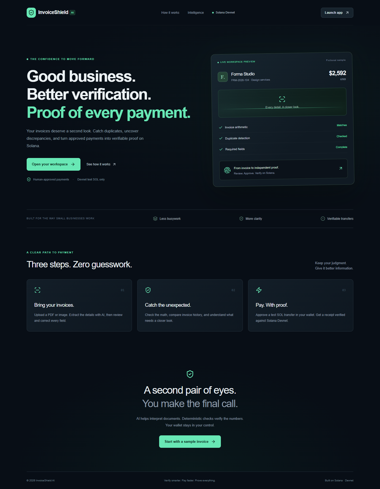
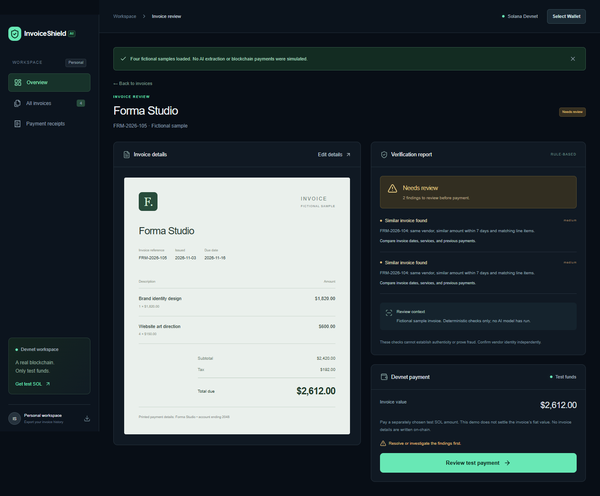

# InvoiceShield AI

**Verify smarter. Pay faster. Prove everything.**

Invoice review and independently verifiable Solana Devnet transfers for small businesses. Built for a beginner hackathon entry: a compact, understandable workflow rather than a custom financial protocol.

## What it does

- Upload a PDF, PNG, or JPEG, preview it, and correct extracted invoice fields.
- Optional OpenAI document interpretation and semantic comparison against summaries of up to 20 recent invoices through a server-only Responses API endpoint with schema validation. Missing values stay null. Invoice content and history are treated as untrusted data.
- Deterministic checks for required fields, subtotal/tax arithmetic, quantity × price, line totals, exact duplicates, similar invoices, unusual amounts, and changed vendor payment details.
- Invoice history in localStorage and original documents in IndexedDB. Export history as JSON. Nothing is shared across devices or users.
- Connect a Solana Wallet Standard compatible wallet through wallet adapter, view its Devnet balance, and explicitly approve a separate test SOL transfer.
- Verify RPC network identity, confirmation, sender signature, transfer recipient, and amount before showing a confirmed receipt. Print or open the transaction on Explorer.
- Samples are clearly fictional. No AI run or blockchain transfer is simulated as real.

## Run locally

Requires Node.js 20.9+ and pnpm 10.11.0. Node 24 was used for local checks.

```sh
corepack enable
pnpm install --frozen-lockfile
cp .env.example .env.local
pnpm dev
```

Open [the local app](http://127.0.0.1:3000). On Windows, copy `.env.example` to `.env.local` using File Explorer or `Copy-Item .env.example .env.local`.

The application works without an AI key through manual entry and deterministic checks. For document extraction, set `OPENAI_API_KEY` on the server. `OPENAI_MODEL` defaults to `gpt-4.1-mini`; choose an account-accessible model supporting image/PDF input and Structured Outputs. Configure `INVOICE_ANALYSIS_TOKEN` for public deployments and enter it in the upload dialog. It is required for paid extraction in production. Never put the API key in a `NEXT_PUBLIC_` variable or commit `.env.local`.

## Try the demo

1. Open the workspace and choose **Explore sample invoices**.
2. Open Forma Studio invoice 104 to inspect the exact duplicate warning. Open invoice 105 to inspect the near duplicate warning.
3. Use the fictional Nimbus Cloud invoice for a clean review, or upload [the normal invoice image](public/samples/normal.png) with AI configured. [Exact duplicate](public/samples/exact-duplicate.png) and [near duplicate](public/samples/near-duplicate.png) images are also included.
4. Connect your wallet and switch its display to **Solana Devnet**. Get test SOL from [Solana Faucet](https://faucet.solana.com/).
5. Choose **Review test payment**, enter an independently confirmed recipient wallet, set a separate test SOL amount (e.g. 0.01), check the approval box, and sign in your wallet.
6. Wait for confirmation and matching receipt verification. If RPC availability is delayed, use **Verify submitted transfer**. Do not send a second payment to resolve a timeout.

Sample loading does not run AI. To demonstrate actual AI extraction, upload a sample image with the server key configured. Samples 104 and its exact copy both flag each other once saved. High-severity findings block payment. The Nimbus sample has no duplicate.

## Validation

```sh
pnpm test
pnpm typecheck
pnpm build
pnpm start
```

See [verification status](docs/VERIFICATION.md) for observed results and checks still requiring credentials or wallet approval. The payment unit tests use mocked RPC and signatures from ephemeral test keypairs; they do not prove a live Devnet transaction happened.

Browser smoke testing is provided by `pnpm test:browser`. It uses installed Edge by default; set `BROWSER_EXECUTABLE` for another installed Chromium browser. The script expects a running local server at port 3000 and no AI key for its fallback assertion. It never signs payments. Run `pnpm samples` to regenerate the fictional PNGs and SVG source assets.

## Architecture

Next.js App Router + TypeScript, Tailwind CSS with a shared fintech design system, Radix Dialog for focus-managed dialogs, and Lucide icons. The only custom backend endpoint is `POST /api/analyze`. AI input is bounded and checked against file signatures and declared MIME type. OpenAI structured output is validated with Zod. Deterministic invoice checks run locally and compare the current browser’s records.

Solana wallet adapter discovers installed Wallet Standard wallets. `@solana/web3.js` creates a System Program transfer on the hardcoded Devnet RPC. A genesis-hash check refuses other networks. The application receives a signed transaction from the wallet, persists its signature before broadcast, then checks confirmation and queries parsed on-chain transfer details. Invoice data never goes into a memo or any other instruction.

Payment duplication protection uses an in-flight guard, a cross-tab Web Lock, and a persisted pending/confirmed record. This prevents accidental repeats in the same browser profile. It is **not** a multi-user payment ledger or protection against clearing browser storage. Production team use needs authenticated, durable server records and server-side idempotency.

## Security and limitations

- Devnet test SOL only. The separately approved SOL amount does not settle the invoice’s USD value. Transfer proof does not verify a vendor’s identity.
- Review findings are evidence to investigate, not a fraud verdict or a guarantee of safety. Duplicate comparisons cover only local history; vendor normalization and similarity rules can produce false positives or miss altered documents.
- Monetary checks currently use two-decimal rounding. Review currencies with other minor-unit conventions manually.
- AI can misread fields. All extracted values require human review. No OCR fallback runs without AI credentials; manual entry remains available for every supported document type.
- Local browser records are not an authenticated accounting system. Device users can modify them. Export excludes original documents. Clearing browser data removes invoice and payment history. Back it up before clearing data.
- A signed but unbroadcast or failed transfer remains locked as pending conservatively. Inspect Explorer / RPC and export the record for diagnosis; the app does not offer an unsafe reset-and-pay-again button.
- Public Devnet RPC is rate limited and can be unavailable. Receipt confirmation may need retries. Only on-curve wallet recipients are accepted; PDA recipients are intentionally excluded.
- The AI access token is shared demo access control, not user authentication. Keep it private, set an OpenAI project spend cap, and rotate it after judging. Production business use needs real authentication, durable rate limits, and account isolation.
- No custom smart contract, escrow, lending, yield, or on-chain invoice storage. DeFi track eligibility has not been established.

## Deployment and submission

See [Vercel deployment](docs/DEPLOYMENT.md), [demo script](docs/DEMO.md), [submission draft](docs/SUBMISSION.md), and [AI development disclosure](docs/AI-DISCLOSURE.md).

No deployment URL is claimed until Vercel account authorization and live checks are complete.

## Screenshots

Browser screenshots are stored under `docs/screenshots/`. They show fictional sample data and must not be used to imply a live payment or live AI test occurred.





## License

Original project code is MIT licensed. Dependencies retain their respective licenses; see the lockfile for exact installed versions. Invoice samples are fictional project assets.

Implementation references: [Next.js installation](https://nextjs.org/docs/app/getting-started/installation), [OpenAI file inputs](https://developers.openai.com/api/docs/guides/file-inputs), [OpenAI Structured Outputs](https://developers.openai.com/api/docs/guides/structured-outputs), and [Solana payment RPC guidance](https://solana.com/docs/payments/interacting-with-solana).
