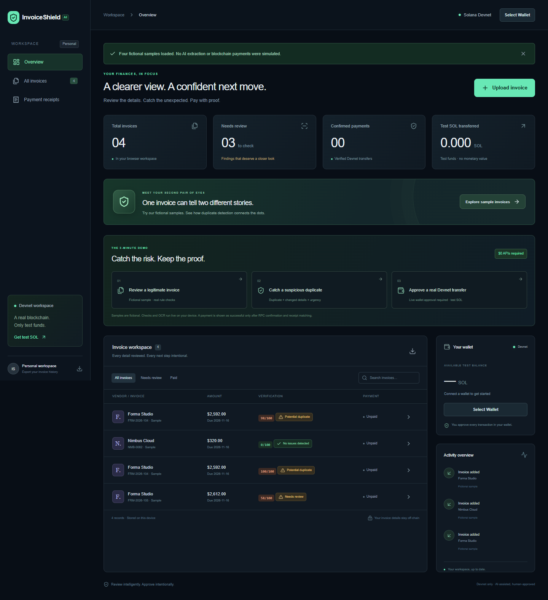
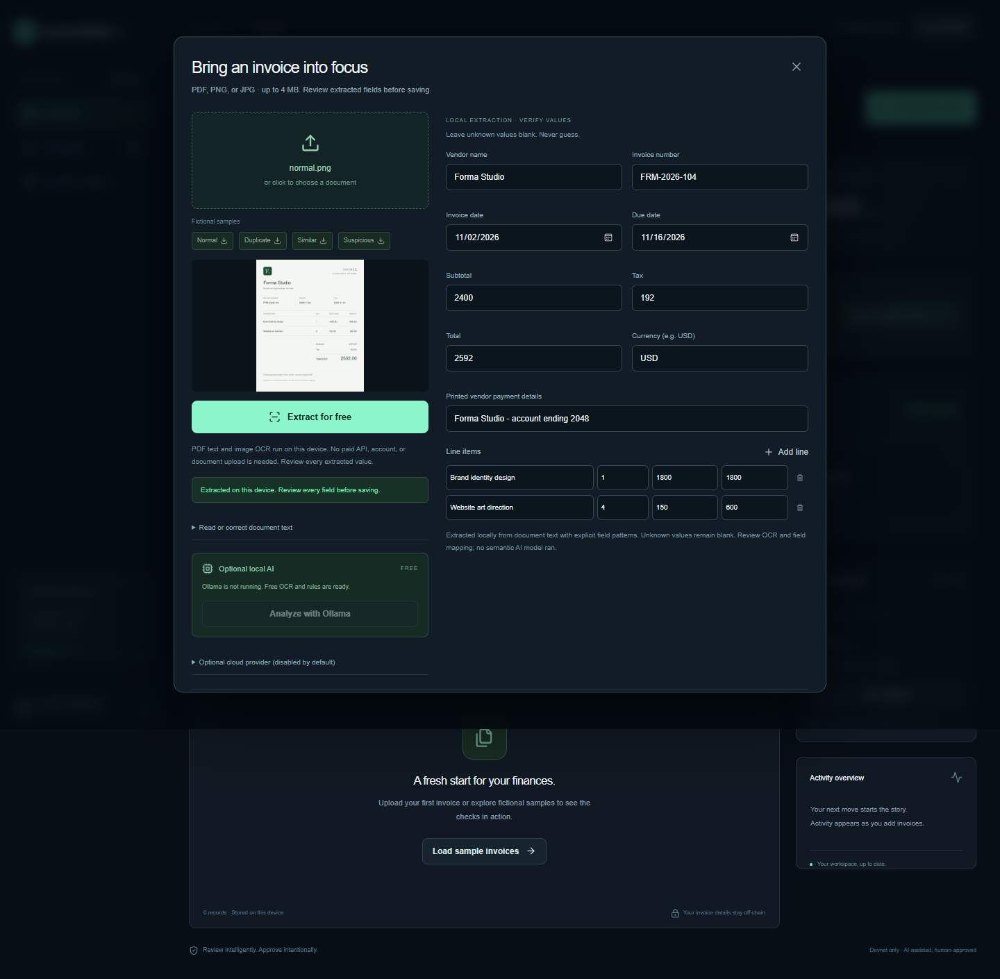
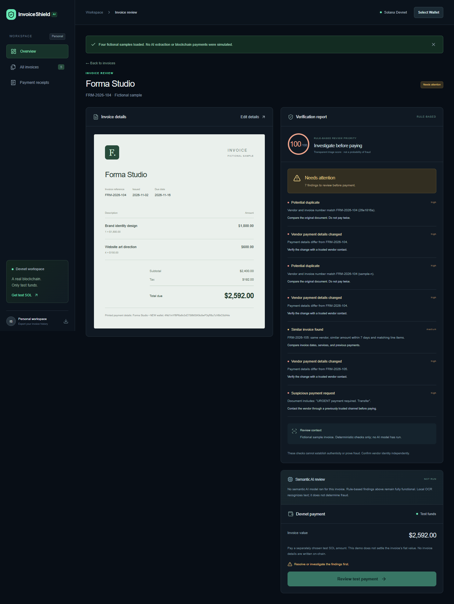

# InvoiceShield AI

**Verify smarter. Pay faster. Prove everything.**

A free-first invoice review workspace with local document reading, explainable risk checks, optional local semantic AI, and wallet-approved Solana Devnet transfers.

## A complete demo without paid APIs

- PDF text extraction with PDF.js and image/scanned-PDF OCR with Tesseract.js run in your browser. Workers and English recognition data are served by this app; documents are not sent to an OCR service.
- Field mapping preserves unknown values as blank. Users can correct fields or paste document text. This is a limited pattern parser, not universal invoice understanding.
- Deterministic rules check arithmetic, exact/near duplicates, changed payment details, unusual amounts, missing fields, urgent/secret payment requests, and embedded review instructions.
- A transparent 0–100 rule-based review-priority score helps triage invoices. It is not a probability of fraud. High findings count 40 points per category, medium 18, informational 5; repeated findings in one category count once.
- Optional Ollama analysis adds a separately labeled semantic report. When no model ran, the interface says so. Local OCR performs text recognition, not a semantic fraud verdict.
- OpenAI remains optional and is disabled by default, even when a key is present. No API credits are required for the demo.
- Wallet Standard connection, Devnet balances, explicitly approved test SOL transfers, confirmation checks, and matched on-chain receipts. No private key or seed phrase is requested or stored.

## Run locally

Use Node 24 and pnpm 10.11.0.

    corepack enable
    pnpm install --frozen-lockfile
    pnpm dev

Open http://127.0.0.1:3000. No environment variables are needed for the free demo. The dev/build scripts prepare local PDF and OCR worker assets automatically. The English OCR model is included in the repository.

If pnpm is already installed, Corepack setup is unnecessary. Windows PowerShell can copy the optional configuration with: Copy-Item .env.example .env.local.

## Two-minute guided demo

1. Open the dashboard. Select Upload invoice, choose public/samples/normal.png, and click Extract for free. This performs real local OCR. Review and save the fields.
2. Select Catch a suspicious duplicate in the guided demo. The fictional sample has a matching invoice number, changed payment details, and urgent instructions. Findings are live deterministic results, not prerecorded AI output. High-severity findings block payment.
3. Select Review a legitimate invoice for the clean fictional Nimbus Cloud record.
4. Connect a compatible Solana wallet, switch its display to Devnet, and get test SOL from https://faucet.solana.com/.
5. Select Approve a real Devnet transfer. Enter an independently confirmed recipient and a separate test SOL amount, check the explicit confirmation, and sign in your wallet.
6. Wait for RPC confirmation and sender/recipient/amount matching. Inspect Explorer and print the receipt. If verification is delayed, retry the same signature; do not send another payment.

The invoice can be in USD while the demo transfer is in test SOL. This transfer does not settle the invoice's fiat value. A transfer receipt does not prove a vendor's identity. The app never simulates a successful payment.

Downloadable PNG samples include normal, exact-duplicate, near-duplicate, and suspicious-duplicate. The guided samples are fictional, prefilled scenario data. Loading them does not claim OCR or a semantic model ran.

## Optional free semantic AI

Ollama is not required to run the demo. It was not installed/running on the development computer during verification. See docs/FREE-DEMO.md for optional setup and limitations.

Install Ollama from https://ollama.com/download/windows, then run:

    ollama pull qwen2.5:1.5b
    ollama serve

The model download is roughly 986 MB; performance depends on your hardware. OLLAMA_MODEL can select another installed model. The app checks for the configured local model and enables Analyze with Ollama when available. Only extracted text and a bounded summary of local history go to the local process. Results are schema validated and shown separately from rules.

A hosted Vercel function cannot reach Ollama on your laptop. The public deployment uses free browser extraction and rule-based review; optional local semantic AI is for the local development server. Never expose Ollama publicly to work around that boundary.

## Optional OpenAI provider

The server endpoint is retained for future use, but ENABLE_OPENAI defaults to false. To opt in separately, the owner must explicitly set ENABLE_OPENAI=true, OPENAI_API_KEY, and INVOICE_ANALYSIS_TOKEN and use the optional cloud button. It may consume paid API credits. It is not used by the free-demo tests. The committed Vercel configuration disables it.

Credentials stay server-only in the ignored .env.local file. They must never be placed in NEXT_PUBLIC variables. The configured key previously reached OpenAI but returned credit_balance_exhausted; successful live OpenAI extraction is not claimed.

## Tests and observed status

    pnpm test
    pnpm typecheck
    pnpm build
    pnpm start

With a server running on port 3000:

    pnpm test:free-demo
    pnpm test:browser

The free-demo browser test performs actual PNG/JPEG OCR and PDF extraction, checks fields against fictional fixtures, inspects suspicious findings, and asserts no cloud AI calls. Browser tests use installed Microsoft Edge by default; BROWSER_EXECUTABLE can select another Chromium browser.

See docs/VERIFICATION.md for actual results and remaining live-wallet/deployment checks. Unit tests use mocked RPC and local-model responses. They are not evidence that a live wallet signed a payment or that Ollama ran.

## Architecture and boundaries

Next.js App Router, TypeScript, Tailwind CSS, Radix Dialog, Lucide icons, PDF.js, Tesseract.js, Zod, Solana wallet adapter, and the Solana JavaScript SDK. Records live in localStorage; original documents live in IndexedDB. JSON export excludes original files. Clearing browser data removes history. There is no shared multi-user accounting backend.

The payment path checks the full Devnet genesis hash, builds a System Program transfer, verifies that the wallet-signed message matches the approved message, persists its signature before broadcasting, and verifies confirmation plus actual transfer details. Network errors can retry receipt lookup without creating another transaction. Cross-tab Web Locks, in-flight guards, and persisted pending records prevent accidental resubmission in one browser profile. They do not provide durable multi-user idempotency.

Upload limits: 4 MB, at most five PDF pages, English OCR. Layout variation and poor scans can cause missing or misread fields. Monetary rules currently use two-decimal rounding. Similarity and suspicious-request rules can generate false positives and miss altered invoices. A zero score does not establish safety or authenticity.

Signed but unbroadcast/failed transactions remain conservatively pending for inspection; the app offers no unsafe reset-and-pay-again shortcut. Public Devnet RPC is rate limited. Only on-curve wallet recipients are accepted. No custom contract, escrow, lending, yield, or real-funds settlement is implemented.

## Submission materials

- docs/DEMO.md: free two-minute script and judge questions.
- docs/DEPLOYMENT.md: free Vercel deployment checklist.
- docs/SUBMISSION.md: honest submission draft and award positioning.
- docs/AI-DISCLOSURE.md: development and runtime AI disclosure.
- docs/FREE-DEMO.md: local-model setup and fallback matrix.

Original code is MIT licensed. Adapted wallet styling, PDF/OCR software, and OCR language data retain their respective licenses; see third-party/README.md.
